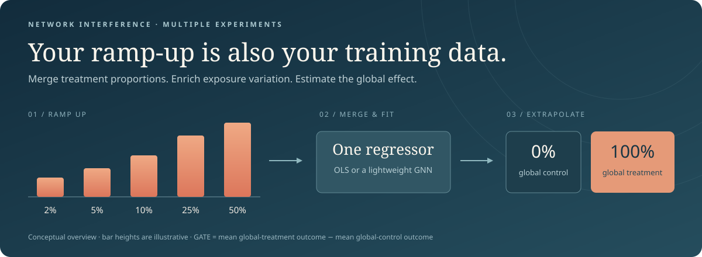

<div align="center">

# Just Ramp-Up

### Debiasing Regression-Based Causal Estimation under Network Interference

**Qianyi Chen · Bo Li**<br>
School of Economics and Management, Tsinghua University

[](https://arxiv.org/abs/2410.12740)
[](https://arxiv.org/abs/2410.12740)
[](pyproject.toml)
[](https://github.com/Cqyiiii/Just-Ramp-up/actions/workflows/tests.yml)

[Paper](https://arxiv.org/abs/2410.12740) · [Quick start](#quick-start) · [Experiments](#experiments) · [Reproducibility](#reproducibility) · [Migration notes](docs/migration.md) · [Citation](#citation)



</div>

Ramp-up experiments already vary the proportion of treated users. **Pooling their data can improve regression-based estimation of the global average treatment effect (GATE)** under network interference by enriching the treatment exposures used for training.

This repository contains the simulation code for **Just Ramp-Up: Debiasing Regression-Based Causal Estimation under Network Interference** (**NeurIPS 2026**), with a configuration-driven experiment runner, sparse graph computations, the paper's lightweight GNN, and reproducible reports. The manuscript is available on [arXiv](https://arxiv.org/abs/2410.12740).

## Quick start

From a Python 3.10+ environment on Linux or macOS:

```bash
git clone https://github.com/Cqyiiii/Just-Ramp-up.git
cd Just-Ramp-up
python -m pip install -e ".[dev]"

# Small synthetic experiment — no Torch, DGL or GPU required.
python -m rampup demo --output outputs/demo
```

Open **`outputs/demo/report.html`** in a browser. It is a standalone, offline report with the frozen configuration, exact estimates, uncertainty, diagnostics and execution history. The demo uses OLS and is an engineering smoke test; it does not reproduce the paper's GNN results.

For GNN experiments, install a matching Torch/DGL CPU environment using the [DGL installation guide](https://www.dgl.ai/pages/start.html), then run:

```bash
python -m rampup demo --estimator gnn --repetitions 2 --epochs 8 --output outputs/gnn-demo
```

See [environment details and tested versions](docs/experiments.md#installation). The project can also be run directly from this checkout with `python -m rampup`; the install adds the equivalent `rampup` console command.

## Experiments

One runner expresses the experimental design along independent axes:

| Component | Choices |
|---|---|
| Potential outcomes | Linear-in-means, multiplicative, quadratic, square-root, two-hop, dynamic graph |
| Assignment level | Unit or cluster |
| Randomization | Complete or Bernoulli |
| Time dependence | Staggered rollout or independent stages |
| Data merging | Final-stage suffixes, baseline pairs, final-stage pairs, repeated experiments |
| Estimator | Graph-agnostic OLS or three-layer ChebConv GNN |

The main paper settings use treatment proportions **2%, 5%, 10%, 25%, 50%**, complete randomization, staggered rollout, **100 Monte Carlo repetitions** and **400 training epochs**. The GNN uses treatment and degree features, Adam at learning rate 0.004, and ChebConv layers `(2,16,2) → (16,16,1) → (16,1,1)`.

```bash
# Validate the real network and inspect its partition.
python -m rampup inspect Dataset/socfb-Stanford3.mtx --clusters

# Fast sparse two-hop check.
python -m rampup run --config configs/smoke-ols.json --output outputs/two-hop-smoke

# Full-sized paper configurations.
python -m rampup run --config configs/paper-linear-unit.json --output outputs/linear-unit
python -m rampup run --config configs/paper-two-hop-cluster.json --output outputs/two-hop-cluster
```

The two principal merging schemes are:

1. **Suffix merging:** final-only, the last two stages, ..., all five stages.
2. **Baseline pairs:** each current stage together with an initial stage treating **exactly one unit or cluster**, approximating global control. Set `baseline="zero"` explicitly for actual global control.

Copy a JSON preset to change the outcome, level or merging scheme. See the [complete configuration and command guide](docs/experiments.md) for semantics, supported combinations and extension points.

## Reproducibility

- **Aligned graph data.** One canonical node order is used for adjacency, assignments, features and outcomes. Two-hop interference is computed sparsely, with closed walks removed.
- **Explicit randomness.** Separate deterministic streams control assignments, outcome noise, graph evolution, clustering and model initialization. Stage data is reused across merge comparisons.
- **Safe recovery.** Each repetition is committed atomically and bound to its frozen run definition. Resume validates configuration, code and data identity, versions, graph mapping and checkpoints; unfinished rows are never treated as numerical zeros.
- **Inspectable evidence.** Every run emits signed bias, standard deviation, MSE, Monte Carlo uncertainty, raw estimates, stage diagnostics and an offline HTML report with a visible machine-readable handoff.

```bash
# Use the same configuration and overrides when resuming.
python -m rampup run --config configs/paper-linear-unit.json --output outputs/linear-unit --resume

# Rebuild a report without rerunning the experiment.
python -m rampup report outputs/linear-unit

# Tests include numerical fixtures, all outcome families, recovery and report validation.
python -m pytest -q
```

**Replication boundary.** The refactor corrects historical node alignment, dynamic graph handling, assignment semantics and completion tracking. These changes are documented in [migration notes](docs/migration.md). New results are not claimed to match the legacy arrays or published tables exactly. In the validation environment, the Stanford graph matches the paper's **11,586 nodes / 568,309 edges**, while deterministic Louvain produces **197 communities**, compared with the manuscript's 192. The actual partition is saved with each cluster run.

The [refactor validation report](reports/refactor-validation.html) records executed engineering checks and small experiments. It is a self-contained HTML artifact; download it and open it locally. A full 100-repetition, 400-epoch paper replication is separate from these checks.

## Repository guide

```text
Just-Ramp-up/
├── rampup/                  # maintained experiment system
│   ├── config.py            # validated scientific configuration
│   ├── graphs.py            # graph loading, clustering and evolution
│   ├── design.py            # treatment assignments and merge groups
│   ├── outcomes.py          # potential outcomes and true GATE
│   ├── estimators.py        # OLS and optional DGL GNN
│   ├── runner.py            # deterministic execution and checkpoints
│   ├── metrics.py           # Monte Carlo summaries
│   └── report.py            # standalone HTML evidence reports
├── configs/                 # small, editable experiment presets
├── tests/                   # numerical and end-to-end verification
├── docs/                    # usage, scientific migration notes and design
├── reports/                 # standalone refactor validation report
├── Dataset/                 # original Stanford3 and Cornell5 graphs
├── Result/                  # preserved historical simulation outputs
└── notebooks/legacy/        # archived original notebooks and browsing index
```

The 37 original notebooks are preserved unchanged in [`notebooks/legacy/`](notebooks/legacy/README.md), with a browsing index and instructions for their repository-root working directory. [The migration map](docs/migration.md#scenario-mapping) explains their configuration equivalents. HT notebooks are legacy-only. The new runner does not claim implementations or reproductions of the manuscript's supplementary MII, Hájek, Lagrange or MIT8 experiments, whose complete source/data is absent from this snapshot.

## Citation

The following entry uses the current manuscript title and retains the original preprint's arXiv identifier and year:

```bibtex
@misc{chen2024justrampup,
  title         = {Just Ramp-Up: Debiasing Regression-Based Causal Estimation
                   under Network Interference},
  author        = {Qianyi Chen and Bo Li},
  year          = {2024},
  eprint        = {2410.12740},
  archivePrefix = {arXiv},
  primaryClass  = {stat.ME},
  url           = {https://arxiv.org/abs/2410.12740}
}
```
